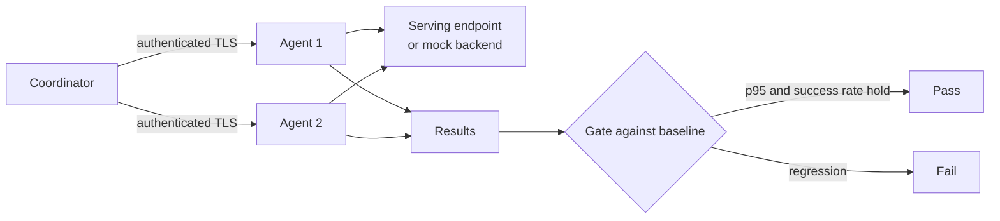

# Triton Inference Benchmark

[](https://github.com/WaffleBits/triton-inference-benchmark/actions/workflows/ci.yml)

A load generator for LLM serving. It sends concurrent requests to a Triton or
OpenAI-compatible endpoint, measures latency and streaming behavior, and fails a
candidate build that regresses against a saved baseline.

## Result

There is no GPU measurement in this repository yet. What CI proves is that the harness
itself holds up: two authenticated TLS agents on one host recover completed work after
response loss and restarts, and the target receives its eight requests with **zero
duplicates**. A benchmark that double-counts or silently loses requests after a failure
reports the wrong answer, so this is the behavior that had to work first.

Sample output in [sample_results](sample_results/mock_run.json) comes from the mock
backend and is illustrative, not a measurement of any model or hardware.

## How it works



## Run it

No GPU or server is needed for the mock backend.

```bash
python benchmark.py --mode mock --num-requests 100 --concurrency 8
python benchmark.py --mode mock --workload-profile long-context --num-requests 200 --concurrency 16 --prometheus
python -m unittest discover -s tests
```

Real endpoints, agents, telemetry capture and every gate are in the
[reference](docs/REFERENCE.md).

## Design decisions

1. **Separate the harness from the client.** Mock, Triton and OpenAI-compatible clients
   share one interface, so phase ordering, retries and statistics are tested without a
   GPU or a model server.
2. **Be conservative across machines.** Agents sample clock offsets and report bounded
   skew and overlap, so a run that did not really start together does not get reported
   as if it had.
3. **Never mistake a chunk for a token.** Streaming chunks and output bytes are kept
   apart from token counts. Token throughput appears only when every successful request
   reports valid usage, and artifacts never contain prompts, endpoints or credentials.

## Limitations

- CI runs against fixtures on a single host. Separate-host agents, bounded clock drift
  and production network faults have not been exercised.
- Lifecycle timing measures process launch to a health check, not model cold start.
- Recovery covers completed shards. In-flight work after a restart is not recovered.

## More

- [Reference: all modes, gates and options](docs/REFERENCE.md)
- [Design notes](DESIGN.md)
- [Operations](docs/OPERATIONS.md)
- [Kubernetes job](deploy/kubernetes/benchmark-job.yaml)
